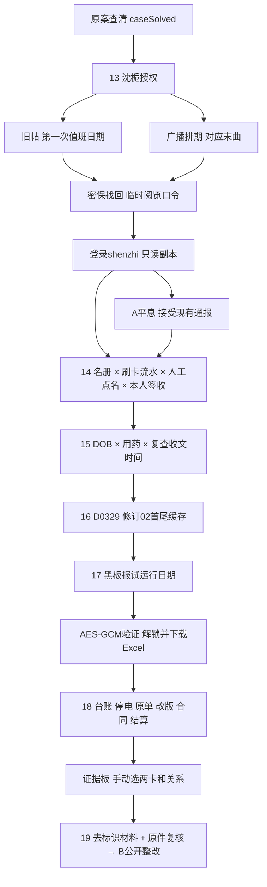

# 《第三份阳性报告》v2.0 线索交互与谜题清单

开发与验收文档，含答案剧透；本文件不进入 `dist/`，不显示在游戏里。

## 新增范围

保留1—12章原案、既有角色及五个宿舍彩蛋。新增13—19章、第四个人物资料账号（已离职实习校医沈栀）、采购协理贺诚、去标识就诊记录R07。原案的假图与后续真实复查材料不是同一份。新增19份文书副本、5组证据关系和A/B两结局。

本篇反转依次是：假图使真实投诉失去可信度；“全程在场”是事后代填；初检阴性不能排除而后续结果已签收；草稿存在互相冲突的旧版、新版；“文件损坏”其实是缺少解密口令；未完成抽检被改为合格，失实台账进入付款依据。不是通过换一个“感染源嫌疑人”推进。

## 流程图

## 谜题清单

| 章节 | 交互 | 上游线索 | 正确核对与后果 |
| --- | --- | --- | --- |
| 13 她已经不在医务室了 | 密保、找回、登录 | 授权信、旧帖、广播排期均公开于本支线起点 | 首次值班2024-09-13，末曲“夜空中最亮的星”；显示账号shenzhi的临时口令sz-read-0331，实际登录后解锁下一章 |
| 14 全班都在，少了一个人 | 名册与三张表各选一行并说明矛盾 | m4名册保管登记、s3有效流水、a2迟补点名、r2本人签收核验 | 卡可能借用，签收才补足身份；解释为事后代填。不能据此认定感染责任 |
| 15 汇总表少了一行 | DOB、用药、复查日期交叉判断 | R07的03-14初检、03-13末次PPI、03-29复查、03-30收文、04-01汇总 | R07 / 0329 / 初检不能据此排除 / 不能反推感染批次。矛盾是已收材料被漏列 |
| 16 发送失败，草稿还在 | 选择缓存片段顺序、清空重排、恢复正文 | 同草稿D0329、修订02、段1/2与2/2 | d2-head → d2-tail；不能混用01版“尚未收到”尾段。恢复得到抽检、付款、附件出处 |
| 17 黑板上的旧日期 | 放大查看日期、真解密、Excel预览与下载 | 黑板报开学日09-02是干扰；说明明确取试运行日 | 20240912；用PBKDF2派生密钥、AES-GCM验证解密，错误口令不会写入解锁状态 |
| 18 合格的那一栏 | 收藏、选两张卡、选关系、画线、提出质疑、移除未提交连线 | 当章六份材料，以及前面留存的到场和医疗材料 | 五组关系全部核实后才能提交公开清单，不接受只选姓名 |
| 19 公告贴上去以后 | 提交或妥协、重读两结局 | 完整清单交原出具单位、设备、财务原件核实 | B公开整改；A接受缺乏医学依据的“个人卫生”通报，保留补证入口 |

## 证据板的五组关系

| 起点 | 关系 | 终点 | 支持的质疑 |
| --- | --- | --- | --- |
| 点名表 | 互相矛盾 | 食堂流水（配套已核验本人签收） | “全程在教室”不成立；只表示到场说法有误 |
| 健康汇总 | 互相矛盾 | R07复查回执及收文 | 后出的汇总漏列先收到的后续结果 |
| 消杀台账 | 互相矛盾 | 停电工单 | 无备用电的电加热设备在断电期间不能连续通电运行 |
| CJ0313原单 | 被改写为 | CJ0313盖章改版 | 未检被改成合格，修订有方向 |
| 合同第7.2条 | 被用于结算 | 三笔付款附页 | 宽松的纸面验收规则承接了失实附件；不是仅凭合同宣称私人侵吞 |

矛盾关系双向等价；改写及结算有方向。错连、重复连线不推进也不扣分。屏幕连线之外保留完整文字列表，移动屏幕与窗口缩放会重绘。

## 无死锁与存档验证

- 主存档键及version保持原值；旧通关存档由 `parseSave` 增补空扩展状态，进入第13章，未通关存档照常推进原案。
- 六个解锁步骤只消费当前或更早层级的证据。密保的三份来源在账号未登录时可读；后续私有材料不会成为密保前置条件。
- 收藏的去标识副本退出阅览账号后仍可阅读；登录找回页始终保留临时口令，不使用真实学校账号。
- 所有输入可重试；缓存可清空重排；口令出处可重读；没有倒计时、永久错失或真实邮件发送。
- A从登录阅览号后可选，不销毁材料、不重置步骤；可继续补齐五组互证进入B。直接改URL不能打开未获得结局。
- 加密附件验证成功后本机存储预览行及下载内容，刷新后仍可用；网络失败、错密钥及损坏密文不推进。
- 保存恢复时从连续完成的步骤重建层级，过滤未知证据与无效关系；损坏的扩展状态不能把玩家留在无前置材料的终章。
- 渐进提示每章三层，重复获取最后一层；心跳音效默认关闭，文字提示始终可读，遵守减少动态效果设置。

`tests/expansion.test.mjs` 实际走过逐章收藏、答题、解密、每步存读档、A再B，以及无效路径。原案16项回归测试保留。

## 医学与叙事边界

13C-UBT的DOB及阴阳阈值为剧情所设医院的报告值，不是通用感染时钟。用药记录用于解释可能的假阴性；复查由故事中的医生核实准备与结论，不指导玩家自行停药。参考 [ACG 2024指南解读](https://gi.org/journals-publications/ebgi/schoenfeld_sep2024/)。

病例集中反映、卫生文书失实、疑似公共卫生问题与确认共同感染源分开处理。餐具抽检原单不曾检测或检出幽门。B中的公开整改和退款基于原件复核；没有把卫生管理问题写成已经证实的传播链。A的“个人卫生问题”是被质疑的校方口径，叙述明确没有查明感染源。

## 对应代码与配置

- `dist/expansion-content.js`：七章、多角色文书、草稿残片、分级提示、双结局。
- `dist/expansion-engine.js`：解锁依赖、存档恢复、题目判定、连线与结局条件。
- `dist/expansion-ui.js`、`dist/expansion.css`：资料柜、密保、表格取证、草稿、附件、证据板、反馈。
- `dist/archive-crypto.js`：WebCrypto解密和.xlsx下载。
- `dist/assets/L-0313.enc.json`、`dist/assets/blackboard-archive.svg`：密文及可核对的口令来源。
- `scripts/build-archive.mjs`：开发者重新生成加密工作簿（含解答，不是现实系统密钥）。
- `dist/app.js`、`dist/engine.js`、`dist/index.html`：旧作接入、兼容存档、缓存版本更新至20。
- `package.json`：`check`覆盖新增模块及测试；`build:archive`重建附件。
- `.github/workflows/pages.yml`：沿用Node24、检查后上传dist再部署Pages；纯静态不需要服务端或额外密钥。

## 验证限制

没有连接可用浏览器，不宣称完成实机点击、视听或截图验收。引擎、实际密码学解密、下载工作簿ZIP/XML、路由生成和发布流水线分别验证。
