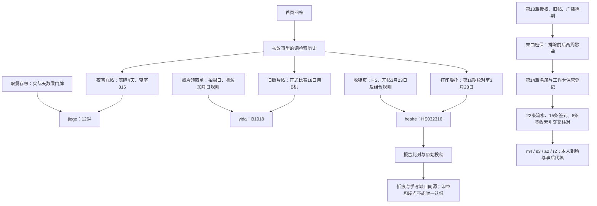

# v2.2 解谜与检索修订

本文件含谜底，供维护者审阅，不在游戏导航或搜索索引里出现。

## 搜索与发现

首页仅保留版务、就医经历、水房灯、失物笔记四帖。分类切换只筛选这四帖，不重新展开历史目录。夜宵账、周测作文、打印委托和运动会旧照片必须经相关搜索发现；人物页和旧链接在未发现时转为检索入口。已发现主题写入原存档，旧存档已读主题自动保留。

支持事件词、相关人物、近义词和输入联想；夜肖、周侧、打映、运功会等常见错字会改词检索并说明修正。空词、全部、校园、life 等不会展开上述四帖。无结果会提供可点击的相关词，不扣分，也不限制重试。

## 线索流程

## 谜题与排除逻辑

| 位置 | 两份上游材料或交互 | 正解 / 干扰 |
| --- | --- | --- |
| 第4章杰哥号 | by持有存根 + 搜索夜宵账帖 | 4×316=1264；0367是取餐号，5×316误用了排班天数 |
| 第5章益达号 | by持有领取单 + 搜索旧照片帖 | B1018；A是17日试拍，C是19日补拍，不是18日比赛 |
| 第7章阅览号 | by持有收稿页 + 搜索打印委托帖 | HS032316；第17期是下期预告。0323单独输入仍提醒补缩写，完整口令忽略大小写、全角及首尾空白 |
| 第7章图像 | A/C并排、叠图、报告B参照、六个候选项 | 折痕与手写圈缺口；印章角度可能批量重复，灰点可能来自设备/扫描底版，均有针对性的驳回，不报正确组合 |
| 第13章密保 | 首次值班旧帖 + 三周广播节目单 | 夜空中最亮的星；平凡之路与稻香同为周五末曲，但日期分别在前后两周 |
| 第14章时间线 | 12行名册 + 三张扩展表 | m4是H017工作卡保管；s3有效关联R0313；a2事后补录全程在场；r2原件核实本人签收。四项及解释均需正确 |

流水含S017与H017、H071的近似编号、邻班消费、走读晚餐、学生获准夜宵时段、同分钟已撤销重试、次日同卡记录及借卡签收。它们在名册、状态、日期或签认人上可排除，不能仅凭消费认定缺勤或认定感染责任。表格可独立滚动、固定表头，单选保留完整行内容及键盘操作。

## 提示与无死锁

- 原案及后续共用三级折叠提示。首次只含一级材料提示；明确点击才载入二级时间/编号关系，再点击才载入三级输入建议。重新打开不自动升级。
- 日常失败反馈说明推理不足，不借错误提交直接公布日期、行号或正确特征；具体答案留在三级提示。
- 每组口令的一份材料始终由by持有，另一份历史帖不依赖待登录账号；登录入口只按原有章节开放。没有使用账号内部资料反过来解锁账号。
- 名册与刷卡、点名、签收同在第14章可读。新存档必须保存名册并正确选择登记；旧版已完成时间线且三份依据齐全的存档只迁移一次，不回退进度。
- 保留阅读1.5秒自动收录、手动保存、口令容错、私人信件后置限制、第12章复查伏笔、A结局后继续补证及全部既有章节。
- 运行 `npm run check` 验证原案与后续完整路径、重载兼容、检索门槛、口令资料可达、干扰错误判定及逐级提示。渲染测试为静态模板验证，不代表浏览器实机验收。
