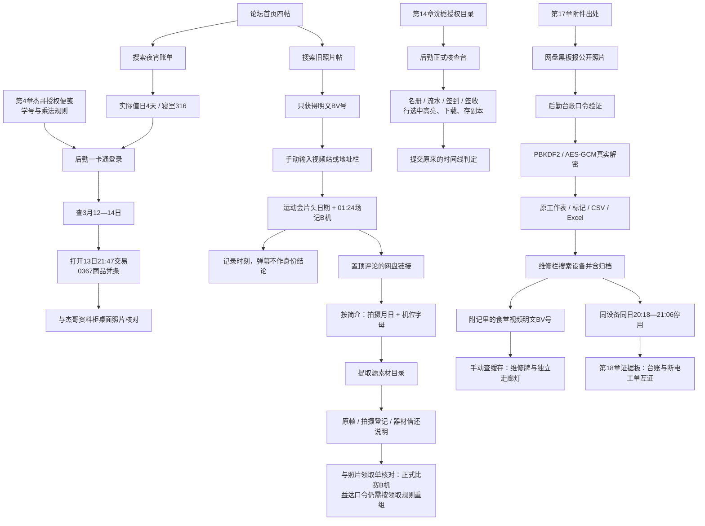

# v2.3 页面生态与跨站线索

本页为维护文档，含谜底；不加入游戏搜索索引。

## 路由与载体

四个域名均为游戏窗口里的地址显示，实际资源仍由同一份 GitHub Pages 静态站提供。切换只改变 hash，不刷新文档，也不访问真实校园服务或真实B站账号。

| 标签 | SPA 路由 | 地址栏显示 | 内容和条件 |
| --- | --- | --- | --- |
| 青禾论坛 | `#forum`、`#post/*`、`#search/*` 等原路由 | `qinghe.local/forum.php` 等 | 保留首页四帖、历史检索、人物账号、调查本与原案 |
| 智慧后勤 | `#portal/home` | `canteen.qinghe.edu.cn/index.aspx` | 蓝白大厅、公告和服务导航 |
| 一卡通 | `#portal/card`、`#portal/order` | 同域 `card.aspx`、`order.aspx` | 第4章起可用；学号、授权口令、日期查询、逐笔打开凭条 |
| 后勤核查 | `#portal/timeline` | 同域 `timeline.aspx` | 第14章起；授权阅览或已保存副本，四表选行和提交 |
| 菜谱/采购 | `#portal/menu` | 同域 `menu.aspx` | 周菜谱、供应公示、CSV；后期链接获准的合同副本 |
| 维修归档 | `#portal/workorders` | 同域 `workorders.aspx` | 第17章起，检索设备并勾选归档才出现旧工单 |
| 台账 | `#portal/ledger` | 同域 `ledger.aspx` | 第17章解密、正式工作表、CSV和原Excel下载 |
| 意见箱 | `#portal/complaints` | 同域 `complaints.aspx` | 旧回复与本地建议草稿，不发送外部消息 |
| 视频检索 | `#video` | `bilibili.com/search` | 输入BV、标题或UP主；默认日常视频，不直接铺出关键花絮 |
| 运动会片段 | `#video/BV1Qh4y1q7Hs` | `bilibili.com/video/BV1Qh4y1q7Hs` | 第5章起，132秒帧序列，01:24场记和定时弹幕 |
| 食堂片段 | `#video/BV1Qh4y1c3Dn` | 对应视频地址 | 第17章起，维修归档里只留明文编号；画面提示设备牌 |
| 社团动态 | `#dynamic/radio` | `bilibili.com/opus/radio` | 摄影社与广播站的动态留存 |
| 青禾网盘 | `#pan`、`#pan/relay` | `pan.qinghe.local/disk/home`、`/s/relay` | 分享链接、提取码、原帧SVG、登记CSV和器材附注 |
| 黑板报相册 | `#pan/blackboard` | `pan.qinghe.local/s/blackboard` | 第17章公开照片及保存副本入口 |
| 设备附件网盘 | `#pan/ledger` | `pan.qinghe.local/s/ledger` | 同一加密文件的分享页；回门户完成实际验证 |

地址栏接受以上存档域名、完整视频链接和BV号。未知域名给出本地反馈，不把玩家跳到站外。四标签各自记录最后访问路由；进度、查询、表格标记、视频时刻及提取记录共用原存档键。

## 线索分布流转图

## 具体谜题与边界

- 一卡通：授权学号20220327；口令仍按存根规则4×316=1264推导。输入日期筛选后，只能从授权的03-13交易打开商品明细。三个不同日期的记录包含秒级时间和机号，错误范围不显示目标凭条。纸存根和口令规则作为by本机便笺可在登录前查看，不构成循环解锁。
- 运动会：拍摄日2024-10-18与上传日10-20分开。01:24（可辨区间01:22—01:28）显示B机牌及文字轨；镜像弹幕怀疑远景里的宋然，热评与器材附注指出不能仅凭人影认人。这个秋季片段用于机位/照片登记，不证明次年三月任何人的行踪或感染关系。
- 网盘：简介明确“拍摄月日四位＋机位字母”，提取码为1018B（大小写、全角和首尾空白容错）。登记将试拍A、正式比赛B、补拍C分开；益达号规则是反过来的“机位字母＋拍摄月日”，仍需回照片领取单推导B1018。
- 后勤时间线：保留v2.2的22条流水、15条点名、12条名册、8条签收和原判定。各表保存、下载、选中行，四个选项加解释必须对齐；允许反复核对，不因错选扣除材料。
- 台账：20240912仍用于实际解密原文件，不用前端假成功替代密码校验。未解密不展示95℃工作表。维修表只在关键词与“含归档”都匹配后出现，断电与台账互证仍进入原证据板。食堂走廊亮灯不等于专用回路供电。
- 公共载体不包含宿舍“圣经”、私人聊天或完整病历。原来的信件后置限制、报告比对、医学可靠性判断、A/B结局和第12章钩子均保留。

## 模块及接入

| 模块 | 职责 |
| --- | --- |
| `dist/network-content.js` | 站点定义、BV元数据、定时弹幕、卡交易、素材登记与工单数据 |
| `dist/network-engine.js` | 路由/地址映射、迁移别名、章节访问条件、查询与提取判定、存档清洗 |
| `dist/site-shell.js` | 四标签、键盘切换、地址输入、站点图标及标题同步 |
| `dist/network-ui.js` | 门户/镜像/网盘页面、表格高亮、视频时钟、跳转与跨站收录 |
| `dist/record-table.js` | 共用正式表格、唯一行标识、带BOM的CSV与本地下载 |
| `dist/video-scene.js` | 可导出的SVG伪画面及随时刻显现的背景细节 |
| `dist/network.css` | 浏览器标签、后勤蓝白、镜像粉白、网盘蓝灰、窄屏与减少动态效果适配 |
| `dist/engine.js` / `dist/app.js` | 增补网络状态与线索；挂载路由、外壳和旧链接重定向 |
| `dist/expansion-ui.js` | 将第14章表格嵌入门户，复用原解密、收藏和时间线判定 |

播放器不依赖远程媒体：CSS/SVG帧序列、定时字幕和弹幕来自本地。音效默认静音；主动开启后有短提示音，本机具备中文语音时可朗读场外对白。所有关键音画信息均有文字轨，静音可完成。隐藏页面、最小化窗口、打开模态阅读器或切换标签会暂停；过期播放回调不能更新新会话。

保持原存档版本和键，旧版补入空网络状态。已保存的receipt可从新交易页重读；旧`casefile/pickup`、`casefile/receipt`、`archive/swipe`等及`vault`会转向新载体。新存档仍需完成相应的查询、提取与解密，章节URL本身不会授予权限。

运行 `npm run check`。新增验证涵盖四站地址、来源可达、日期查询、机位/上传日干扰、提取口令、CSV、真实解密表格、旧存档和媒体生命周期。渲染验证使用模板与控制器单元测试，不替代浏览器实机视觉验收。
