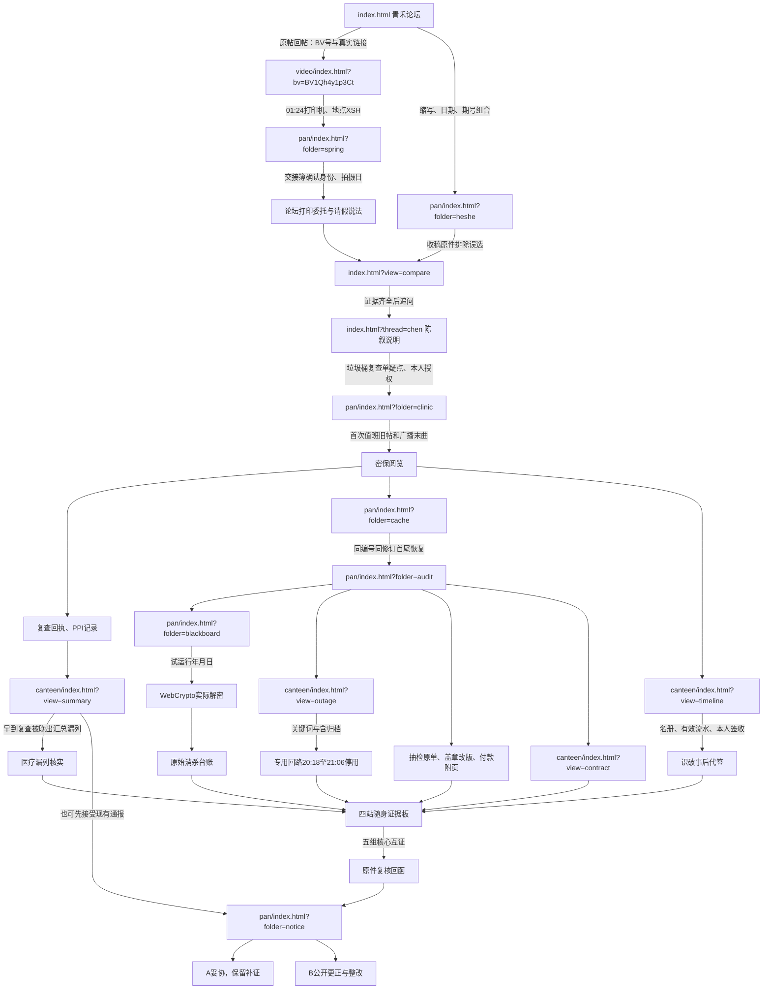

# v3.0 四站物理拆分与证据驱动重构

维护文档，含谜底。生产入口不再使用假浏览器、系统切换标签或章节计数器。

## 物理目录与页面骨架

```text
dist/index.html                 forum.js
dist/canteen/index.html         canteen/site.js
dist/video/index.html           video/site.js
dist/video/mock-player.js       video/frames/{spring,autumn}-01..04.svg
dist/pan/index.html             pan/site.js
dist/state-sync.js              单一存档、storage监听、挂载随身抽屉
dist/arg-engine.js              权限、证据判定、事实依赖和迁移
dist/arg-content.js             原有逻辑文书与新增场记
dist/arg-ui.js                  自动阅读、文书、表格、相对链接
dist/arg-pinboard.js            随身调查本、连线、手记、微反馈
dist/arg-hints.js               三级渐进提示
dist/arg.css                    公共与论坛样式
dist/network.css               各站原有独立视觉
dist/archive-crypto.js          原PBKDF2 + AES-GCM与XLSX下载
```

四份HTML均显式加载 `state-sync.js`，随后各自的入口脚本。共享模块不包含四站页面路由器。

```html
<!-- canteen/index.html；video和pan采用同样的独立骨架 -->
<!doctype html>
<html lang="zh-CN">
<head>
  <meta charset="utf-8">
  <meta name="viewport" content="width=device-width,initial-scale=1,viewport-fit=cover">
  <link rel="stylesheet" href="../network.css?v=42">
  <link rel="stylesheet" href="../arg.css?v=42">
</head>
<body data-site="canteen">
  <main id="app" tabindex="-1"></main>
  <script type="module" src="../state-sync.js?v=42"></script>
  <script type="module" src="site.js?v=42"></script>
</body>
</html>
```

从论坛到视频是 `video/index.html?bv=BV1Qh4y1p3Ct`；从视频到资料夹是 `../pan/index.html?folder=spring`；从网盘到后勤是 `../canteen/index.html?view=timeline`；从后勤回原帖是 `../index.html?thread=reports`。均为真实超链接，不拦截为SPA跳转，不使用根绝对路径，保留GitHub项目站点前缀。

## 相对 URL 拓扑与线索闭环



夜宵与益达支线可穿插：旧账→一卡通查询→杰哥桌面照片；旧照片帖→秋季视频→机位登记→益达号。私人信件和藏手机音游仅在宿舍资料柜内，不放公开论坛。

## 三层事实与非线性依赖

春季片段拍摄于2025年3月14日下午，对应陈叙的周测缺席及请假说法。2024年秋季片段只用于机位/照片谜题，不拿它证明次年三月行踪。

第一层要求报告A/C、阿哲来源、打印委托、原始收稿、请假说法、春季关键帧和交接场记，并核对独特纸面痕迹。弹幕与远景本身不能识别身份或证明改图；原件、接触及本人说明补足闭环。

第二层分别核对到场、医疗并恢复草稿。三个分支可交错。R07初检准备不足，复查经医生确认；R09另有复查阳性送达，R12仍待复查不列为确诊。后出汇总遗漏先到的后续材料，能证明漏列，不能证明共同传播来源。

审计附件只依赖已恢复草稿，可以先于医疗/到场核验解密。B结局仍需要第二层完成、五组关系和复核回函。

| 核心关系 | 独立前提 | 判定 |
| --- | --- | --- |
| 点名 ↔ 流水 | 名册、本人签收、到场核验 | 互相矛盾 |
| 汇总 ↔ 复查 | 用药与收文先后核验 | 互相矛盾 |
| 台账 ↔ 停电 | 原加密包实际解开（Excel含消杀台账与结算附页） | 互相矛盾 |
| 原单 → 改版 | 同文号与修订出处 | 被改写为，有方向 |
| 合同 → 结算 | 草稿确认付款附件出处 | 被用于结算，有方向 |

## 单一事实数据源及兼容

唯一活动写入键为 `qinghe_arg_save`，结构如下：

```js
{
  version: 3, clock: 0,
  evidence: {}, accounts: {}, actions: {}, links: {},
  prefs: {}, notes: {}, marks: {}, vault: null
}
// 字段项：{value, tick, actor}；取消连线保留value:false墓碑。
```

命令先合并内存与磁盘最新快照，再判定证据前提和同步写入。`storage`事件合并本地、对端事件值与磁盘；陈旧写入覆盖另一页独立发现时修复写回。版本比较和稳定序列化保证交换、结合和幂等；修复不增加时钟，避免事件抖动。手记/偏好采用最后写入；连线墓碑防止被旧页复活。

首次无新存档时，只读旧 `qinghe.third-report.v1` 与 `qinghe.presentation.v1`，经旧解析器核验后迁移原案事实、账号、副本、草稿、工作表、关系和手记。以后四站只写新键。旧UI模块保留回归，但不被生产入口加载。旧hash书签转成真实页面地址，不再按章节推进。

## 自动阅读与随身抽屉

关键图像/正文可见、窗口有焦点且未被模态抽屉遮挡，连续1.5秒后收录。图片需加载完成；隐藏、失焦、跳页或素材切换会取消旧计时。点击高亮字段也可立即收录，没有“保存线索”按钮。

四站共用调查本，只显示已取得的卡片。点两卡与关系形成文字和连线反馈；“翻原件”是真实跨页链接。轻提示音默认关闭。三级提示按需展开，未主动请求的详细答案不进入抽屉DOM。

## 四帧播放器

`video/mock-player.js`维护时钟、四帧索引与取消令牌；`video/site.js`负责淡入淡出、推焦、DV时间、水印、文字轨和8—9条定时弹幕。每段四张本地SVG，无MP4、外部播放器和视频解码服务。受保护秋季源素材夹另含班级合照缩略复印件。

置顶评论 `00:00 / 00:28 / 01:24 / 01:52` 可直接定位切片。弹幕按播放时刻计算，回看可再次出现。隐藏页面、抽屉覆盖或离开文档会暂停；取消后的旧回调不能继续改变时钟。春季/秋季各有独立日期及源素材，不混用时间线。

## 验证与发布

`npm run check`包含旧回归和新架构验证：物理入口与相对资源、模块导出、证据前提、不同探索顺序、实际解密、五条质疑、A后继续补证、storage并发收敛/墓碑、损坏存档、迁移、年份和播放生命周期。

GitHub Actions仍校验后发布 `dist`，无需后端、依赖安装、重写规则或环境变量。GitHub Pages的HTTPS满足WebCrypto。当前验证涵盖逻辑、控制器和静态资源，不代替浏览器实机视觉验收。
