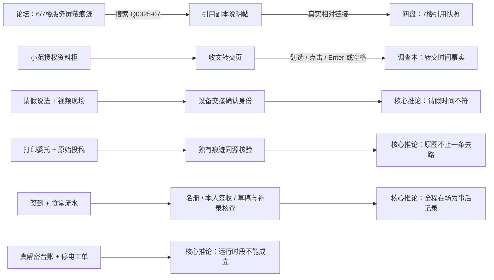

# v3.1 搜证交互与推导说明（含剧透）

正文只展示站点自身业务内容；所有推论、跨站辅助和版本说明归入调查本。新材料是旁证，不新增通关必选项。

- Q0325-07于3月25日18:42保存，版主于26日暂时屏蔽，原作者于28日撤回；副本不披露匿名账号实名。
- JK-0330-07-R仅向已获授权的调查者展示。打码是文字底色，底层文字为“03月30日 16:20”；仍需和复查签收及后勤汇总核对。材料没有患者姓名，不判断传播来源。
- `deductions`使用固定推论ID和原有逻辑时钟记录，不接受存档中的任意推论文本。生成前检查已收材料、佐证及必要核验。跨标签合并保留独立发现。
- 选择两张卡既可发起轻量推导，也可继续提出原有审计关系；两者不互相代替。无关配对不消耗材料，重复推导不重复新增笔记。
- v3.0.3存档保持schema version 3；没有deductions时补空集合，不凭已通关状态自动赠送推论。原A、B流程仍须通过原证据与核验条件。

后续v3.2在原链上补充日常校时锚点与终局复盘准入，最新条件见[V3.2-RECONSTRUCTION.md](V3.2-RECONSTRUCTION.md)。
