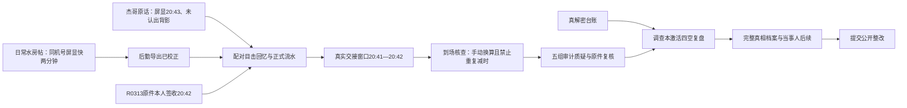

# v3.2 推理链与终局复盘（含剧透）

本次不新增调查支线，沿既有改图、医务室与后勤审计链强化校验。

1. 水房帖进入`clockNote`，主帖5楼原话进入`screenMemory`。后门终端QH-HM01在13日屏显快两分钟，正式导出已应用该偏差。不能把屏显20:43当导出时间，也不能从20:41再减一次。R0313本人签收20:42是独立校验。
2. 原笔记帖的领稿条补足第16期与第17期预告的区分，为原有校刊口令提供额外日常旁证，不新增密码。
3. 到场核查新增校时输入和“是否重复换算”的判断；读过两个回帖才能提交。已核实的旧版到场记录不被撤销。
4. 新的“记住的是屏幕，不是准确时刻”推论指出时间基准差异，不把记忆偏差认定为撒谎，也不根据背影确认身份。身份仍由本人签收核验。
5. 解密深层表后可在调查本底部填写复盘，但通过前必须具备原有审计闭环、复核回函和记忆纠偏。四空为断电窗口、对应设备、未检改合格用于结算、朱贵使用by原图改日期匿名投稿。各选项独立校验；失败不消耗证据。
6. `caseReconstructed`加入原有actions；最后一次提交保存在marks的`case-reconstruction`。未提交的下拉选择在本页重绘中保留，不随其他线索入库清空。
7. 新调查须复盘通过后才能提交B结局。旧存档已完成的B记录及档案查阅继续保留，A记录也不清除；没有已完成结局时，不凭一次解密赠送复盘完成标记。
8. 最终档案分别说明改图与后勤责任，仍不声称查明感染来源。整改退款限于无法证明完成的对应服务分摊费用。
