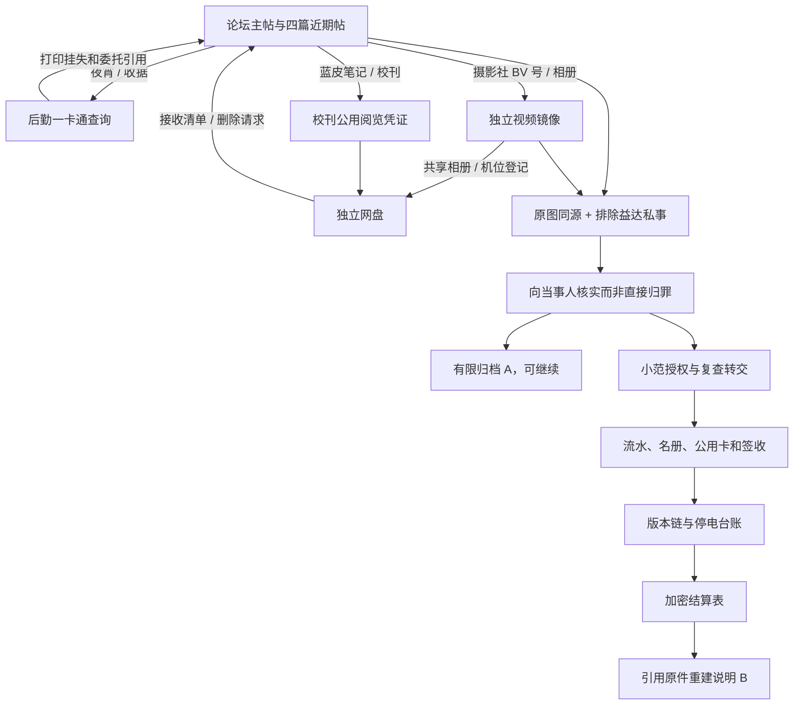

# 入口、证明与解答 / 剧透

三条入口是备用发现途径，不是必须打卡三页。每项结论至少两个**独立形成**的原件支持；同一张图的转发只算一个来源。P1 仅实现下表标有 P1 的材料与验证，其余是冻结设计，未伪装成可玩内容。

## 十二谜题冻结表

| # / 题目 | 三条发现入口 | 独立来源 / 可替代证明组合 | 正确边界与排错 | 实现 |
| --- | --- | --- | --- | --- |
| 1 同源报告 | 主帖附件、周测回帖、校刊接收清单 | by 原件+匿名图+自行标记后加折痕及蓝圈；可由校刊收稿原件替代 by 的论坛图，但两者不能双计独立 | 模板横线/印章角度不能唯一识别；仅推断复制，不直接认人 | P1 |
| 2 夜宵误会 | 杰哥回复、一卡通补打小票、水房闲聊 | 收据+桌面照片，或收据+益达当天记录。记录与回忆有作者区别 | 车仔面是食堂夜宵；不设置“车仔面还是火鸡面”争论。共同吃面不能证明传播来源 | P1 |
| 3 删三张 | 原话、蓝皮笔记、照片袋目录 | 删除请求+照片袋编号/时间，或接收清单+照片袋。拒绝信正文非必读 | F1018 文件组属 2024-10-18；报告为 R0315，不能把删除动作错套 | P1 |
| 4 校刊共享阅览 | 蓝皮帖、精华归档说明、投稿回执 | 03-23 收稿日期+本期16，前缀HS在公用阅览规则。3 条入口可找到上述两个事实 | HS032316，大小写/NFKC/首尾空格容错；0323提示缩写和期号；17是预告期 | P1 |
| 5 运动会相册 | BV 号、摄影社回复、机位登记摘要 | 实拍03-21+机位B+共享命名规则；上传03-24不是实拍日 | 0321B；另有0320试拍与0322补拍，均不符合正片登记 | P1 公开登记+提取 |
| 6 请假与流转 | 视频背景、打印委托、请假原话 | 视频+交接场记构成返校质疑；责任另需源文件保存记录+投稿凭据/当事人相关承认 | 背影不能独立认人，返校不排除上午就医，接触不等于编辑 | P1 仅形成待核实质疑；核实在P2 |
| 7 医务室授权 | 朱贵说明、工作草稿引用、后勤收文栏 | 授权函+首班登记+广播节目单，验证日期/末曲，不猜私密密码 | 9/13、夜空中最亮的星；9/12试岗和9/16换班为合理干扰，授权范围只读去标识文件 | P2 |
| 8 复查漏列 | 准备核对页、复查回执、无新增汇总引用 | 医生准备记录+有效复查；出具方留底+收文单+对应截点汇总 | DOB不能判感染批次；复查不等于新增，先核对汇总定义再指认漏列 | P2 |
| 9 双时钟 | 水房回帖、维修登记、收银备注 | HM01校时记录+目击原话+流水基准说明，或同屏拍摄+校时登记+流水 | 20:43屏显→20:41服务器；已校正导出不再减两分 | P1 埋入口，P2完整 |
| 10 公用卡 | 名册、投诉回复、代班记录 | 借卡记录+本人签收+带时间的代班记录；不能用公用卡独立认人 | 走读/借卡/事后补签为干扰。只能定位实际签收，不能泛称全员造假 | P2 |
| 11 文书版本链 | 版务快照、草稿引用、出具方回执 | 出具方留底+校内盖章版+修订流水 | 区分未检→合格内容改写、一般补录、撤回。离职草稿不能单独定责 | P2 |
| 12 运行结算 | 工单、试运行记录、付款附件索引 | 同设备停电+运行台账+解密原表与付款引用；试运行日有工单/黑板/登记三入口 | 20240912，PBKDF2+AES-GCM；只在解密成功后显示原表。无电时段与记载运行冲突不等于病原传播证明 | P2 |

真正的密码组仅 4、5、12；7 是持授权函的身份核验，不是破解他人私人账号。

## 材料生产预算（34份）

P1：by 原报告、匿名附件、夜宵回执、桌面照片、宿舍记录节选、删除请求、照片袋目录、校刊收稿清单、蓝皮领稿条、共享阅览规则、摄影社机位登记、春季相册、交接场记、请假原话，共14份。正文来源保留在各站原生结构，调查本只做索引和个人解释。

P2：乌鸡报告、朱贵相关源文件与投稿凭据、授权函、值班登记、广播排期、初检/准备核对、有效复查、收文单、汇总、校时记录、目击原话、公用卡借用、名册、本人签收、代班记录、草稿修订、抽检双版、停电工单、运行台账、加密结算原表，共20份。相关同一原件的不同页是一个逻辑材料，不通过拆页虚增数量。

## P1 关卡出入口检查

- 四站首页均可不带存档访问；玩家身份固定为by，网盘默认列表是“与我共享”，不代表公开全网的私人笔记；权限只限制共享文件内容，不封锁站点首页。
- 口令可从公开规则、公开帖子和回执推导，不要求先读受保护的同一文件。
- 视频有键盘拖动、字幕、逐图相册与场记；不能因播放能力缺失卡住。
- 证明组合允许替代，候选版总结只验证已做出的判断与引用，未收全14份也可完成。
- 假设可撤回，错误判断不消耗原件；报告模板和印章干扰有驳回原因。
- 三份同图副本不充当三份独立证据；未阅读私信/拒绝信全文仍有正路。
- 没有P2页面的假链接或“下一章”按钮；候选范围与盲测反馈入口只写在调查本。
